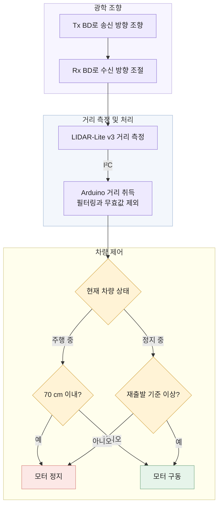

# 26_HC124

### The BD : Be Deep

# BD-LiDAR 융합 기반 자율주행차량 사각지대 해소 및 능동형 AI 객체인식 시스템 개발

---

## 💡1. 프로젝트 개요

**1-1. 프로젝트 소개**

- **프로젝트 명** : BD-LiDAR 융합 기반 자율주행차량 사각지대 해소 및 능동형 AI 객체인식 시스템 개발
- **프로젝트 정의** : 액정 Beam Deflector(BD)를 단일 포인트 LiDAR의 송신부(Tx)와 수신부(Rx) 앞에 붙여 기계적 회전 없이 탐지 방향을 넓히고, 측정한 거리로 RC 차량의 정지와 재출발을 제어하는 프로젝트
- **구현 결과** : BD 구성에 따라 **검출 각도 2° → 14° → 18° 확장**, LIDAR-Lite v3 기반 RC 차량의 **장애물 감지와 정지 및 재출발 구현**
- **확장 방향** : YOLO 객체 인식과 Unity 시각화를 LiDAR 거리와 결합한 능동형 인지

<p align="center">
  
</p>
<p align="center"><sub>LiDAR만 쓸 때와 BD를 붙였을 때의 검출 범위 비교 개념도</sub></p>

**1-2. 개발 배경 및 필요성**

| 개발 배경 | 해결하고자 하는 문제 |
| :--- | :--- |
| **자율주행 인지** | 카메라 영상만으로는 장애물까지의 거리를<br>정확히 알기 어려워 거리 정보가 함께 필요 |
| **회전형 LiDAR의 부담** | 본체를 모터로 돌려 시야를 넓히는 대신<br>가격, 부피, 차체 돌출, 유지보수 부담이 큼 |
| **단일 포인트 LiDAR의 한계** | 탐지 방향이 고정되어 측면과 후방을 보지 못하고<br>여러 대를 달면 배선과 보정 부담이 늘어남 |
| **비기계식 조향의 과제** | MEMS 미러는 진동 보상이,<br>OPA는 크로스토크와 grating lobe 억제가 과제 |
| **조향과 검출은 별개** | 빛을 원하는 방향으로 보내도 반사광이 수신부에<br>충분히 들어오지 않으면 거리가 출력되지 않음 |

본 프로젝트는 **단일 포인트 LiDAR에 BD를 결합해 탐지 방향을 넓히고**, 넓어진 영역에서 감지한 장애물에 차량이 반응하도록 구현했다.

**1-3. 프로젝트 특장점**

| 구분 | 핵심 내용 |
| :--- | :--- |
| **비기계식 조향** | 액정 BD의 전압 패턴만 바꿔 빛의 진행 방향 제어 |
| **송수신 동시 조향** | Tx 조향으로 생긴 수신 한계를 Rx BD로 보완 |
| **검출 범위 확장** | BD 미적용 2° → Tx BD 14° → Tx와 Rx BD 18° |
| **실물 차량 구현** | LIDAR-Lite v3 거리값으로 RC 차량의 정지와 재출발 제어 |
| **인지 기능 확장** | YOLO 객체 인식과 Unity 시각화를 각각 구현 |

- **BD 조향 원리** : BD 하부의 패턴 전극에 서로 다른 전압을 걸면 액정 배향이 위치마다 달라져 유효 굴절률 차 Δn이 생기고, 위상 지연 Δφ = 2πΔnd/λ (d : cell gap)가 톱니 모양의 위상 격자를 이룬다. 빛은 격자 주기 p에 따라 θ = sin⁻¹(λ/p) 방향으로 회절하므로, 전압 패턴만 바꿔 조사 방향을 바꾼다.
- **Rx BD가 필요한 이유** : LiDAR는 반사광이 검출 임계값을 넘을 만큼 들어와야 거리를 출력하므로, 검출 범위는 beam이 닿는 범위가 아니라 거리가 출력되는 범위로 정했다. 조향된 beam의 반사광은 Rx 광축에서 기울어진 방향으로 돌아오고, Rx 렌즈는 수용각 안으로 들어온 빛만 검출기에 모은다. Rx 앞의 BD가 이 빛을 Rx 광축 쪽으로 다시 꺾으면서 검출 각도가 14°에서 18°로 넓어졌다.
- **v3를 적용한 이유** : 레이저 광원인 v3는 beam 발산각이 작아 조향한 방향에만 에너지가 모이므로, 그 방향에 있는 물체의 반사광으로 거리를 얻는다.

<p align="center">
  
</p>
<p align="center"><sub>Tx와 Rx 앞에 BD를 하나씩 배치한 실험 구성</sub></p>

**1-4. 주요 기능**

| 기능 | 구현 내용 | 진행 상태 |
| :--- | :--- | :---: |
| **광학 조향** | Tx와 Rx 앞 BD에 전압을 걸어 송수신 방향 조절 | 구현 |
| **수신 보완** | Rx BD 조절로 조향 방향의 거리 검출 회복 | 확인 |
| **거리 취득** | LIDAR-Lite v3와 Arduino 간 I²C 통신 | 구현 |
| **거리값 처리** | 필터로 변동을 줄이고 무효 측정값 제외 | 구현 |
| **차량 제어** | 70 cm 이내 접근 시 정지, 거리 확보 시 재출발 | 구현 |
| **AI 객체 인식** | YOLO 기반 영상 내 객체 검출 | 독립 구현 |
| **주행 시각화** | Unity 가상 LiDAR 감지 시 HUD 경고 표시 | 독립 구현 |

YOLO와 Unity는 각각 동작을 확인했으며, 실제 LiDAR 데이터와의 실시간 연동은 후속 개발 항목이다.

**1-5. 기대 효과 및 활용 분야**

- **사각지대 보완** : 고정된 단일 탐지 방향을 전기적으로 넓혀 주변 장애물 감지에 활용
- **구성 단순화** : LiDAR 한 대로 여러 방향을 살펴 LiDAR 수량과 배선을 줄이고, 회전부가 없어 마모와 차체 돌출이 없음
- **적용 분야** : 소형 자율주행 플랫폼, 이동 로봇, 차량의 측면과 후방 근거리 장애물 감지
- **후속 발전** : 객체 종류와 거리 정보를 함께 활용하는 능동형 인지 및 제어

**1-6. 기술 스택**

| 구분 | 사용 기술 및 장비 | 활용 |
| :--- | :--- | :--- |
| 광학 조향 | 액정 BD (Tx용, Rx용), BD Driving Board | 송수신 방향 조절 |
| 거리 측정 | Garmin LIDAR-Lite v3 | 장애물 거리 측정 |
| 제어 보드 | Arduino UNO R4 WiFi | 거리 취득과 차량 제어 |
| 구동 장치 | 모터 드라이버 (TB6612FNG), DC 모터, RC 차량 | 주행과 정지 |
| 펌웨어 | Arduino IDE, C/C++ | LiDAR 통신과 제어 로직 |
| 데이터 분석 | MATLAB | 실험 데이터 정리와 비교 |
| 광학 설계 | Zemax | 수신 광학계 검토 |
| 객체 인식 | Python, YOLOv8 (Ultralytics), OpenCV | 영상 기반 객체 검출 |
| 시각화 | Unity, C# | 가상 LiDAR와 HUD 구현 |
| 광학 계측 | IR 카메라, Photodiode, Oscilloscope | beam 관찰과 세기 측정 |

---

## 💡2. 팀원 소개

| 구분 | 주요 역할 | 담당 내용 |
| :--- | :--- | :--- |
| **팀원 1** | 프로젝트 총괄 | 시스템 구성, 광학 실험 및 결과 종합 |
| **팀원 2** | 실험 및 분석 | 측정 데이터 정리, 성능 분석 및 개발보고서 |
| **팀원 3** | 실험 및 검증 | 조향 실험, 결과 비교 및 개발보고서 |
| **팀원 4** | 제어 및 시각화 | Arduino 차량 제어, Unity 및 제작설계서 |
| **팀원 5** | 자료 및 영상 | 발표 자료, 시연 영상 및 제작설계서 |
| **멘토** | 기술 자문 | 구현 방향 검토 및 기술 피드백 |

---

## 💡3. 시스템 구성도

**3-1. 하드웨어 구성**

<p align="center">
  
</p>

| 연결 구간 | 연결 방식 | 역할 |
| :--- | :--- | :--- |
| 배터리 → Arduino, 모터 드라이버 | 전원 | 전원 공급 |
| PC → BD Driving Board | USB | BD 구동 조건 설정 |
| BD Driving Board → Tx와 Rx BD | 위상 제어 전압 | 송수신 방향 조절 |
| LiDAR → Arduino | I²C | 측정 거리 전달 |
| Arduino → 모터 드라이버 | PWM 제어 신호 | 주행과 정지 명령 |
| 모터 드라이버 → DC 모터 | 모터 구동 전력 | 차량 움직임 제어 |

**3-2. 제작한 RC 차량**

<p align="center">
  
</p>

| 구성 | 제작 내용 |
| :--- | :--- |
| **광학부** | LiDAR 송수신부에 BD 배치 및 광축 정렬 |
| **제어부** | Arduino 기반 거리 취득 및 상태 판단 |
| **구동부** | 거리 조건에 따른 RC 차량 정지 및 재출발 |

**3-3. 동작 흐름**



**차량 제어 기준**

| 현재 상태 | 거리 조건 | 제어 결과 |
| :--- | :--- | :--- |
| 주행 중 | 70 cm 이내 | 차량 정지 |
| 주행 중 | 70 cm 초과 | 주행 유지 |
| 정지 중 | 재출발 기준 미만 | 정지 유지 |
| 정지 중 | 재출발 기준 이상 | 주행 재개 |

- **정지 기준을 70 cm로 정한 이유** : 처음에는 50 cm에서 정지하도록 시험했으나, 주행 속도를 높이자 제동거리가 길어져 차량이 물체에 더 가까이 가서 멈췄다. 정지 명령이 나간 뒤에도 차량은 측정과 제어에 걸리는 시간 동안 속도에 비례하는 거리를, 모터가 감속하는 동안 속도의 제곱에 비례하는 거리를 더 움직이기 때문이다.
- **정지와 재출발 기준을 나눈 이유** : 기준이 하나뿐이면 정지 직후 측정값이 잡음과 진동 때문에 기준 위아래를 오가며 정지와 출발이 번갈아 실행된다. 재출발 기준을 정지 기준보다 멀게 두면 두 기준 사이에서는 직전 상태가 유지된다.

**3-4. 개발 과정 및 문제 해결**

| 개발 단계 | 확인한 문제 | 원인과 개선 |
| :--- | :--- | :--- |
| **Tx 단독 조향** | 빛의 방향은 바뀌었지만<br>일정 각도부터 검출이 늘지 않음 | 반사광이 Rx 수용각 밖으로<br>돌아오는 것으로 판단 |
| **수신 구조 검토** | 기울어져 돌아오는 반사광을<br>수신부로 모을 방법 필요 | Kepler, Cassegrain 광학계 검토<br>부피가 커지고 방향마다 맞추기 어려움 |
| **Rx BD 추가** | 고정 렌즈로는<br>조향 방향 변화에 대응하기 어려움 | Rx 앞 BD로 수광 방향을 맞춰<br>거리 검출 회복 |
| **v3 적용** | 차량 적용에 맞는<br>beam 특성과 검출 동작 필요 | 퍼짐이 작은 레이저 beam으로<br>조향과 타깃 검출 개선 |
| **차량 통합** | 거리 측정 결과를<br>실제 동작으로 연결 | 장애물 감지에 따른<br>정지와 재출발 구현 |
| **제동거리 대응** | 속도를 높이자 50 cm 기준으로는<br>물체에 더 가까이 가서 멈춤 | 정지 기준을<br>70 cm로 조정 |

**핵심 확인 방법** : 타깃 위치와 Tx 조건을 유지한 상태에서 Rx BD만 조절해 거리 검출이 회복되는지 확인했다.

**3-5. 실험 결과**

**① BD 적용에 따른 검출 각도 확장**

| 비교 항목 | BD 미적용 | Tx에만 BD 적용 | Tx와 Rx에 BD 적용 |
| :--- | :---: | :---: | :---: |
| **검출 각도** | **2°** | **14°** | **18°** |

Tx BD로 탐지 방향을 넓히고 Rx BD로 수신 방향을 맞춰 **검출 각도를 2° → 14° → 18°로 넓혔다**.

**② LIDAR-Lite v3 기반 차량 동작**

| 시험 항목 | 동작 결과 |
| :--- | :--- |
| 장애물이 70 cm 이내로 다가올 때 정지 | 동작 확인 |
| 장애물 근접 상태에서 정지 유지 | 동작 확인 |
| 거리 확보 후 재출발 | 동작 확인 |

**3-6. AI 객체 인식 및 시각화**

| 구분 | 구현 내용 | 후속 연동 |
| :--- | :--- | :--- |
| **YOLO** | 영상 내 객체 검출 | 객체와 LiDAR 거리 정보 연결 |
| **Unity** | 가상 LiDAR 및 HUD 시각화 | 실제 측정 데이터 표시 |

<p align="center">
  
</p>
<p align="center"><sub>Unity 안의 가상 LiDAR(Ray)가 보행자를 감지하면 로그가 '감지됨'으로 바뀌고 윈드실드 HUD에 경고가 표시된다. 실물 LiDAR 데이터와는 아직 연결하지 않았다.</sub></p>

후속 개발에서는 영상과 거리 정보의 시간과 좌표를 맞춰, **어떤 객체가 어느 방향에 얼마나 가까이 있는지** 판단하도록 확장한다.

---

## 💡4. 작품 소개영상

- **시연 내용** : BD-LiDAR 장애물 감지, RC 차량 자동 정지와 안전거리 확보 후 재출발

<!-- 아래 두 곳의 영상ID를 유튜브 주소 youtu.be/ 뒤의 값으로 바꿀 것 -->
[](https://youtu.be/영상ID)

---

## 💡5. 핵심 소스코드

**5-1. LiDAR 거리 취득**

- **소스코드 설명** : LIDAR-Lite v3를 초기화하고 I²C 통신으로 측정 거리를 읽어오는 코드. 측정 요청부터 거리값 반환까지의 핵심 함수를 제시한다.

```cpp
// LiDAR 거리 취득 코드
```

**5-2. 거리값 필터링 및 예외 처리**

- **소스코드 설명** : 거리값의 변동을 줄이고 유효하지 않은 측정값을 구분하는 코드. 필터 처리와 오류 발생 시 처리 방식을 제시한다.

```cpp
// 거리값 필터링 및 예외 처리 코드
```

**5-3. 차량 정지 및 재출발 제어**

- **소스코드 설명** : 현재 차량 상태와 측정 거리를 비교해 모터를 제어하는 코드. 70 cm 정지 기준과 그보다 먼 재출발 기준을 구분한 상태 전환 로직을 제시한다.

```cpp
// 차량 정지 및 재출발 제어 코드
```

**5-4. 외부 기술 활용 및 자체 구현 범위**

| 구분 | 활용 및 구현 범위 |
| :--- | :--- |
| **제공 장치** | 액정 BD 및 구동 장치를 활용한 조향 실험 |
| **상용 하드웨어** | LiDAR, Arduino 및 모터 드라이버 활용 |
| **외부 소프트웨어** | LiDAR 라이브러리, YOLO 및 Unity 활용 |
| **자체 구현** | 송수신 BD 배치와 정렬, 실험 설계 및 분석,<br>거리 처리와 차량 제어 로직, 시각화 구성 |
