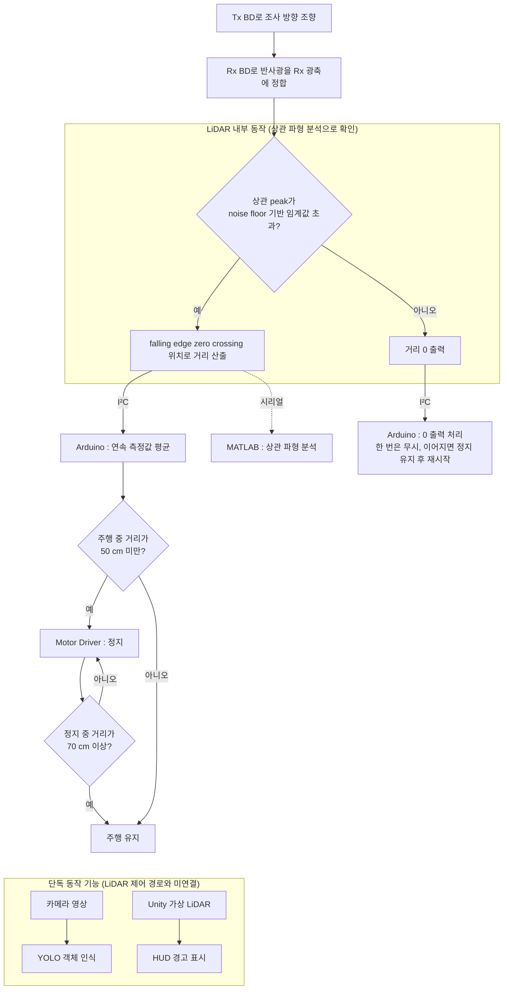

# 26_HC124
BD–LiDAR 융합 기반 자율주행차량 사각지대 해소 및 능동형 AI 객체인식 시스템 개발
# BD-LiDAR 융합 기반 자율주행차량 사각지대 해소 및 능동형 AI 객체인식 시스템 개발

---

## 💡1. 프로젝트 개요

**1-1. 프로젝트 소개**

- **프로젝트 명** : BD-LiDAR 융합 기반 자율주행차량 사각지대 해소 및 능동형 AI 객체인식 시스템 개발
- **프로젝트 정의** : 액정 Beam Deflector(BD)를 고정형 LiDAR의 송신부(Tx)와 수신부(Rx) 앞에 붙여 기계적 회전 없이 측정 방향을 바꾸고, 측정한 거리로 RC 차량의 정지와 재출발을 제어하는 프로젝트
- **핵심 구현** : BD를 이용한 LiDAR 조사 방향 조향, Tx와 Rx 광경로 분석, 상관 파형(Correlation Record) 분석, Arduino 기반 정지와 재출발 제어

<p align="center">
  
</p>
<p align="center"><sub>LiDAR만 쓸 때와 BD를 붙였을 때의 감지 범위 비교 개념도</sub></p>

**1-2. 개발 배경 및 필요성**

- **고정형 LiDAR의 사각지대** : 구동부가 없는 고정형 LiDAR는 조사 방향이 고정되어 차량 측면과 후방의 사각지대를 보지 못한다. 이를 메우려 여러 대를 나눠 달면 배선과 보정 부담이 다시 늘어난다.
- **회전형 LiDAR의 제약** : 모터와 베어링으로 본체를 돌려 넓은 시야를 얻지만, 가격과 부피가 크고 차체 밖으로 돌출되며 구동부 마모에 따른 유지보수가 필요하다.
- **다른 비기계식 조향 방식의 과제** : MEMS 미러는 진동 보상이, OPA는 크로스토크와 grating lobe 억제가 과제로 남아 있다. 액정 BD는 전압만으로 빛을 꺾는 얇은 셀이어서 기존 LiDAR 앞에 그대로 붙일 수 있고, 응답 속도와 회절 효율이 개선 과제다.
- **조향과 거리 검출은 별개** : 송신 beam을 원하는 방향으로 보내도 물체에서 돌아온 반사광이 Rx에 충분히 들어오지 않으면 LiDAR는 거리를 출력하지 않는다. 그래서 조향 성능은 beam이 움직인 각도가 아니라 실제로 거리가 출력되는 범위로 따져야 한다.
- **측정과 제어의 연결** : 넓어진 측정 범위가 의미를 가지려면 그 거리로 차량을 실제로 멈추고 다시 출발시킬 수 있어야 한다.

**1-3. 프로젝트 특장점**

- **회전부 없는 조향** : BD 하부의 패턴 전극에 서로 다른 전압을 걸면 액정 배향이 위치마다 달라져 유효 굴절률 차 Δn이 생기고, 위상 지연 Δφ = 2πΔnd/λ (d : cell gap)가 톱니 모양의 위상 격자를 이룬다. 빛은 격자 주기 p에 따라 θ = sin⁻¹(λ/p) 방향으로 회절하므로, 전압 패턴만 바꿔 조사 방향을 바꾼다. LiDAR 본체는 그대로 두고 앞에 붙이는 방식이다.
- **송신과 수신을 함께 조향** : Tx 앞에만 BD를 두었을 때 감지 경계는 0°의 2.9 cm에서 4°의 4.0 cm까지 바깥으로 이동했지만, 5°\~6°에서는 4.0 cm에 머물렀고 7°에서는 3.8 cm로 줄었다. IR 카메라로 beam이 목표 위치까지 조향된 것을 확인했으므로 원인을 수신 쪽에서 찾았다. 조향된 beam의 반사광은 Rx 광축에서 기울어진 방향으로 돌아오는데, Rx 렌즈는 수용각 안으로 들어온 빛만 검출기에 모으기 때문에 이 빛을 받지 못한다. Rx 앞에도 BD를 두어 돌아오는 빛을 Rx 광축 쪽으로 다시 꺾자, Rx BD를 조향하지 않았을 때 거리가 끊겼던 위치에서 Tx 1°\~9° 모든 조건의 거리 출력이 회복되었고, Tx 9°에서는 6.5 cm 위치의 물체까지 거리가 나왔다.
- **조향 한계의 원인 분석** : Tx 10°(물체 위치 7 cm)에서는 Rx를 1°\~8° 중 어느 각도로 조향해도 거리가 나오지 않았다. 물체가 측면으로 갈수록 물체 표면의 난반사광 중 Rx 쪽으로 향하는 성분이 Lambert cosine 법칙에 따라 cos θ′에 비례해 줄고, 경로 R이 길어지면서 Rx 개구가 받는 입체각(πD²/4R²)이 R²에 반비례해 작아진다. 두 효과가 겹쳐 상관 파형의 peak가 검출 임계값을 넘지 못한 것으로 분석했다.
- **감지 경계를 거리 출력으로 정의** : beam이 닿는 영역이 아니라 Arduino에 거리 값이 출력되는 위치를 감지 경계로 정하고, 모든 조향 실험을 이 기준으로 비교했다. LiDAR는 반사 신호의 상관 peak가 noise floor 기반 임계값을 넘을 때만 거리를 내보내므로, beam이 물체에 닿아도 수광량이 부족하면 측정되지 않기 때문이다.
- **거리 산출 원리 분석** : LIDAR-Lite v4 LED의 상관 파형 192점을 시리얼로 직접 읽어 기준 신호 구간(0\~63)과 반사 신호 구간(64\~191)으로 나눴다. 9 m, 9.5 m, 10 m에서 비교하자 거리가 멀수록 반사 신호가 뒤쪽 index로 이동했는데, index가 송신과 수신 사이의 지연 시간에 대응하기 때문이다. 흰색과 검은색 타깃을 같은 거리에서 비교했을 때는 peak 크기만 달라지고 거리 값은 대체로 유지되었다. 이를 근거로 거리는 반사 신호 falling edge의 zero crossing 위치로 정해지고, peak 크기는 거리 출력 여부만 가른다고 판단했다.

<p align="center">
  
</p>
<p align="center"><sub>Tx와 Rx 앞에 BD를 하나씩 배치한 실험 구성</sub></p>

| 거리 조건별 상관 파형 | 흰색과 검은색 타깃의 상관 파형 |
|:---:|:---:|
|  |  |

<details>
<summary>조향 실험 측정값</summary>

**Tx BD만 조향 : 조향각별 감지 경계 (거리 값이 출력된 가장 바깥 물체 위치)**

| Tx 조향각 | 0° | 1° | 2° | 3° | 4° | 5° | 6° | 7° |
|:---:|:---:|:---:|:---:|:---:|:---:|:---:|:---:|:---:|
| 물체 위치 (cm) | 2.9 | 3.2 | 3.5 | 3.8 | 4.0 | 4.0 | 4.0 | 3.8 |

**Tx와 Rx BD 함께 조향 : Rx BD를 조향하지 않았을 때 거리가 끊긴 위치에 물체를 두고 Rx만 조향**

| Tx 조향각 | 물체 위치 | 거리 출력이 회복된 Rx 조향각 |
|:---:|:---:|:---:|
| 1° | 3.1 cm | 2°\~5° |
| 2° | 3.3 cm | 3°\~6° |
| 3° | 3.7 cm | 2°\~6° |
| 4° | 3.9 cm | 2°\~6° |
| 5° | 4.2 cm | 2°\~6° |
| 6° | 4.0 cm | 2°\~7° |
| 7° | 4.1 cm | 2°\~6° |
| 8° | 5 cm | 3°\~6° |
| 9° | 6.5 cm | 7°\~8° |
| 10° | 7 cm | 없음 (1°\~8° 시험) |

Tx 8°\~10°는 거리 값 변화가 뚜렷하지 않아 IR 카메라로 찾은 beam 중심에 물체를 두었다.

</details>

**1-4. 주요 기능**

| 기능 | 내용 | 구현 현황 |
| :--- | :--- | :--- |
| BD 기반 조향 | Driving Board로 Tx와 Rx 앞 BD에 전압을 인가해 조사 방향과 수광 방향을 바꿈 | 구현 |
| 상관 파형 분석 | 상관 파형 192점 취득, MATLAB으로 거리 조건별 파형 자동 비교 | 구현 |
| LiDAR 레지스터 설정 | 신호 누적 횟수, 고정밀 모드, 검출 민감도를 근거리 응답 속도 우선으로 설정 | 구현 |
| 거리 기반 정지와 재출발 | 50 cm 미만에서 정지, 정지 후 70 cm 이상에서 재출발 | 구현 |
| 측정 오류 처리 | 연속 측정값 평균, 0이 이어지면 정지 유지 후 Arduino 재시작 | 구현 |
| YOLO 객체 인식 | 카메라 영상에서 보행자, 차량, 장애물의 종류와 위치 검출 | 구현, LiDAR와 미연결 |
| 객체 인식과 거리 결합 | 인식한 객체에 LiDAR 거리를 붙여 위험도 판단 | 진행 중 |
| Unity 디지털 트윈 | 가상 LiDAR가 보행자를 감지하면 HUD에 경고 표시 | 구현, 실물 LiDAR와 미연결 |

- 신호 누적 횟수를 늘리면 반사 신호가 더 쌓여 정확도와 최대 거리가 늘지만 한 번 측정에 걸리는 시간이 길어진다. 차량 정지에는 근거리에서의 빠른 응답이 중요하므로 응답 속도를 우선했다.
- 0이나 이상값이 한 번 나온 것으로는 제어를 바꾸지 않는다. 0이 정해진 횟수 이상 이어지면 정지를 유지하고 Arduino를 재시작해, 일시적인 측정 오류가 전체 동작 중단으로 이어지지 않게 했다.

> **구현 범위** : YOLO 객체 인식과 Unity 디지털 트윈은 각각 단독으로 동작한다. YOLO 검출 결과와 LiDAR 거리의 실시간 결합, Unity와 실물 LiDAR 데이터의 연결은 진행 중이다.

**1-5. 기대 효과 및 활용 분야**

- **기대 효과** : LiDAR 한 대의 측정 방향을 전기적으로 바꿔 측면과 후방을 살피므로 LiDAR 수량과 배선을 줄일 수 있다. 회전부가 없어 마모와 차체 돌출이 없다. 객체 인식과 거리 결합이 완성되면 거리만 보는 경고에서 객체 종류까지 고려한 위험도 판단으로 넘어갈 수 있다.
- **활용 분야** : 자율주행 차량과 ADAS의 측면 및 후방 사각지대 감지, 버스와 화물차의 저속 근거리 충돌 방지, 물류 차량과 무인 이동체, 교차로와 횡단보도에 설치하는 V2X 연계 교통 인프라
- **향후 과제**
  - 시연용 구성에서 Tx 단독 조향과 Tx와 Rx 동시 조향의 감지 경계를 같은 조건으로 다시 비교
  - v4 LED는 LED 광원이라 beam 발산각이 4.77°로 넓고 v3는 레이저 광원이므로, 두 LiDAR의 BD 미적용 감지 범위를 같은 조건에서 비교해 시연용 LiDAR 선정
  - RC 차량의 정지와 재출발 동작을 반복 시험해 현장 시연 안정성 확보
  - YOLO 검출 결과와 LiDAR 거리 결합, Unity와 실물 LiDAR 데이터 연결

**1-6. 기술 스택**

| 구분 | 기술 및 장비 | 사용 목적 |
| :--- | :--- | :--- |
| 광학 소자 | 액정 Beam Deflector (Tx용, Rx용), BD Driving Board | 조사 방향과 수광 방향 조향 |
| 거리 측정 | Garmin LIDAR-Lite v4 LED (940 nm, ToF), LIDAR-Lite v3 (비교 진행 중) | 거리 측정, 상관 파형 취득 |
| 제어 하드웨어 | Arduino UNO R4 WiFi, Motor Driver (TB6612FNG), DC 모터 구동 RC 차량 | 거리 수집, 정지와 재출발 제어 |
| 펌웨어 | C/C++ (Arduino IDE), LIDAR-Lite 라이브러리 | 측정 모드 설정, 제어 로직 |
| 데이터 분석 | MATLAB | 상관 파형 자동 수집과 비교 |
| 광학 설계 | Zemax | Rx 수광 광학계(케플러, 카세그레인) 검토 |
| 영상 객체 인식 | Python, YOLOv8 (Ultralytics), OpenCV | 카메라 영상 객체 검출 |
| 가상 환경 | Unity | 가상 주행 환경, HUD 경고 |
| 광학 계측 | IR 카메라, Photodiode, Oscilloscope | 조향된 beam 관찰, 위치별 beam 세기 측정 |

---

## 💡2. 팀원 소개

| 구분 | 주요 담당 역할 | 보고서 및 자료 제작 |
| :---: | :--- | :--- |
| **김영빈 (팀장)** | 프로젝트 전체 총괄, 연구 및 개발 방향 조율, 진행 관리 | 개발보고서 중심 작성, 전체 내용 취합 및 검토 |
| **김나영** | 실험 데이터 정리, 분석 및 고찰 | 개발보고서 중심 작성 |
| **김민서** | 실험 데이터 정리, 분석 및 고찰 | 개발보고서 중심 작성 |
| **곽민상** | RC 차량 제어, Unity 시뮬레이션 개발 | 제작설계서 중심 작성 |
| **문근휘** | 프로젝트 자료 정리, 소개 및 시연 영상 제작 | 제작설계서 중심 작성 |
| **박정현** | LiDAR 기술 자문, 실험 해석 검토 | - |

> 개발보고서와 제작설계서는 팀원 전원이 함께 작성했고, 표에는 각자의 주요 담당 업무를 적었다.

---

## 💡3. 시스템 구성도

**3-1. 하드웨어 구성도**

<p align="center">
  
</p>

배터리가 Arduino UNO R4 WiFi와 Motor Driver에 전원을 공급한다. Arduino는 I²C로 LiDAR 거리를 읽고 PWM으로 DC 모터를 구동하며, PC와 제어 명령 및 상태 데이터를 주고받는다. PC에 USB로 연결된 BD Driving Board 두 개가 Tx와 Rx 앞의 BD에 위상 제어 전압을 인가한다.

**3-2. 프로토타입 구성**

<p align="center">
  
</p>
<p align="center"><sub>RC 차량 위에 BD, Driving Board, LiDAR, Arduino, Motor Driver를 올린 실물</sub></p>

**3-3. 동작 흐름도**



| 차량 상태 | 판단 기준 | 동작 |
| :--- | :--- | :--- |
| 주행 | 거리 50 cm 이상 | 주행 유지 |
| 장애물 접근 | 주행 중 거리 50 cm 미만 | 정지 |
| 정지 유지 | 정지 중 거리 70 cm 미만 | 정지 유지 |
| 재출발 | 정지 중 거리 70 cm 이상 | 주행 재개 |
| 측정 오류 | 0 또는 이상값 | 한 번은 무시, 이어지면 정지 유지, 정해진 횟수를 넘으면 Arduino 재시작 |

**3-4. Unity 가상 주행 환경**

<p align="center">
  
</p>
<p align="center"><sub>Unity 안의 가상 LiDAR(Ray)가 보행자를 감지하면 로그가 '감지됨'으로 바뀌고 윈드실드 HUD에 경고가 표시된다. 실물 LiDAR 데이터와는 아직 연결하지 않았다.</sub></p>

---

## 💡4. 작품 소개영상

- **시연 내용** : BD-LiDAR 장애물 감지, RC 차량 자동 정지와 안전거리 확보 후 재출발

<!-- 아래 두 곳의 영상ID를 유튜브 주소 youtu.be/ 뒤의 값으로 바꿀 것 -->
[](https://youtu.be/영상ID)

---

## 💡5. 핵심 소스코드

**5-1. LiDAR 거리 측정**

- **소스코드 설명** : takeRange()로 측정을 시작하면 LiDAR 상태 레지스터(0x01)의 busy flag가 1이 되고, 측정이 끝나면 0으로 돌아온다. flag가 0이 된 뒤에 거리 레지스터(0x10, 0x11)를 읽어야 직전 측정값이 아니라 이번 측정값을 얻는다.

```cpp
myLidar.takeRange();                          // 측정 시작
while (myLidar.getBusyFlag()) { }             // busy flag가 0이 될 때까지 대기
uint16_t distance = myLidar.readDistance();   // 이번 측정의 거리 (cm)
Serial.println(distance);
```

**5-2. 거리 기반 정지와 재출발**

- **소스코드 설명** : 임계값이 하나뿐이면 정지 직후 측정값이 잡음과 차량 진동 때문에 임계값 위아래를 오가면서 정지와 출발이 번갈아 실행된다. 정지는 50 cm 미만, 재출발은 70 cm 이상으로 기준을 나누면 측정값이 두 기준 사이에 있는 동안 직전 상태(isStopped)가 유지되어 반복 전환이 생기지 않는다.

```cpp
const int STOP_THRESHOLD = 50;   // 정지 임계거리 (cm)
const int GO_THRESHOLD   = 70;   // 재출발 임계거리 (cm)
bool isStopped = false;

void controlVehicle(int distance) {
  if (!isStopped && distance < STOP_THRESHOLD) {
    stopVehicle();               // Motor Driver 정지 신호
    isStopped = true;
  }
  else if (isStopped && distance >= GO_THRESHOLD) {
    driveVehicle();              // 주행 재개
    isStopped = false;
  }
}
```

